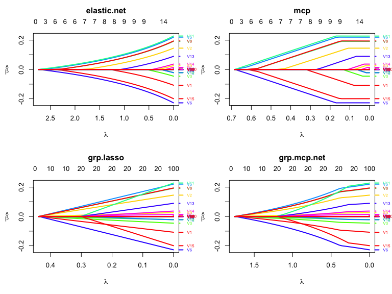

[](https://cran.r-project.org/package=oem)
[](https://ci.appveyor.com/project/jaredhuling/oem)

## Introduction

The oem package provides estimation for various penalized linear models
using the [Orthogonalizing EM
algorithm](https://doi.org/10.1080/00401706.2015.1054436). Documentation
for the package can be found here: [oem
site](https://jaredhuling.org/oem/).

Install using the **devtools** package (RcppEigen must be installed
first as well):

``` r
devtools::install_github("jaredhuling/oem")
```

or by cloning and building using `R CMD INSTALL`

## Citation

To cite oem please use:

Xiong, S., Dai, B., Huling, J., Qian, P. Z. G. (2016) Orthogonalizing
EM: A design-based least squares algorithm, Technometrics, Volume 58,
Pages 285-293,  
<http://dx.doi.org/10.1080/00401706.2015.1054436>.

Huling, J.D. and Chien, P. (2022), Fast Penalized Regression and Cross
Validation for Tall Data with the oem Package, Journal of Statistical
Software, Volume 104, Issue 6, <https://doi.org/10.18637/jss.v104.i06>.

## Penalties

### Lasso

``` r
library(microbenchmark)
library(glmnet)
library(oem)
# compute the full solution path, n > p
set.seed(123)
n <- 1000000
p <- 100
m <- 25
b <- matrix(c(runif(m), rep(0, p - m)))
x <- matrix(rnorm(n * p, sd = 3), n, p)
y <- drop(x %*% b) + rnorm(n)

lambdas = oem(x, y, intercept = TRUE, standardize = FALSE, penalty = "elastic.net")$lambda[[1]]

microbenchmark(
    "glmnet[lasso]" = {res1 <- glmnet(x, y, thresh = 1e-10, 
                                      standardize = FALSE,
                                      intercept = TRUE,
                                      lambda = lambdas)}, 
    "oem[lasso]"    = {res2 <- oem(x, y,
                                   penalty = "elastic.net",
                                   intercept = TRUE, 
                                   standardize = FALSE,
                                   lambda = lambdas,
                                   tol = 1e-10)},
    times = 5
)
```

    ## Unit: milliseconds
    ##           expr       min        lq      mean    median        uq       max
    ##  glmnet[lasso] 1260.3136 1276.4218 1299.1889 1309.9995 1321.8656 1327.3437
    ##     oem[lasso]  426.5575  428.8234  445.0209  443.6717  453.7979  472.2539
    ##  neval cld
    ##      5  a 
    ##      5   b

``` r
# difference of results
max(abs(coef(res1) - res2$beta[[1]]))
```

    ## [1] 1.04823e-07

``` r
res1 <- glmnet(x, y, thresh = 1e-12, 
               standardize = FALSE,
               intercept = TRUE,
               lambda = lambdas)

# answers are now more close once we require more precise glmnet solutions
max(abs(coef(res1) - res2$beta[[1]]))
```

    ## [1] 3.763212e-09

### Accelerated OEM Iterations

By default, the OEM iterations are accelerated with FISTA and adaptive
restarting (`accelerate = "fista"`). SQUAREM (`accelerate = "squarem"`)
is also available, and `accelerate = "none"` gives the plain OEM
iterations. Acceleration matters most when the variables are strongly
correlated, where plain OEM needs many iterations for each value of
lambda. Below, the variables follow an AR(1) correlation structure with
correlation 0.9 between neighbors, and each fit is compared with a
tightly converged `glmnet` fit on the same lambda sequence. The first
row uses plain OEM with the previous default of 500 iterations per
lambda.

``` r
set.seed(123)
n <- 2000
p <- 500
x <- matrix(rnorm(n * p), n, p)
for (j in 2:p) x[, j] <- 0.9 * x[, j - 1] + sqrt(1 - 0.9 ^ 2) * x[, j]
b <- c(runif(10, -1, 1), rep(0, p - 10))[sample(p)]
y <- drop(x %*% b) + rnorm(n)

lambdas <- oem(x, y, penalty = "lasso")$lambda[[1]]
ref <- as.matrix(coef(glmnet(x, y, lambda = lambdas, thresh = 1e-14)))

settings <- list("plain, maxit = 500" = list(accelerate = "none", maxit = 500),
                 "plain"              = list(accelerate = "none"),
                 "fista (default)"    = list(accelerate = "fista"),
                 "squarem"            = list(accelerate = "squarem"))

comparison <- t(sapply(settings, function(s) {
    time <- system.time(fit <- do.call(oem, c(list(x, y, penalty = "lasso", lambda = lambdas), s)))
    maxit <- if (is.null(s$maxit)) 5000 else s$maxit
    c(seconds          = unname(time["elapsed"]),
      iterations       = sum(fit$niter[[1]]),
      lambdas_at_maxit = sum(fit$niter[[1]] >= maxit),
      max_diff_glmnet  = max(abs(fit$beta[[1]] - ref)))
}))
comparison
```

    ##                    seconds iterations lambdas_at_maxit max_diff_glmnet
    ## plain, maxit = 500   1.075      48343               93    6.300760e-03
    ## plain                8.153     368041               46    7.046760e-06
    ## fista (default)      0.839      35633                0    3.737041e-06
    ## squarem              0.549      22979                0    3.723342e-06

``` r
system.time(glmnet(x, y, lambda = lambdas, thresh = 1e-10))
```

    ##    user  system elapsed 
    ##   1.358   0.012   1.371

### Nonconvex Penalties

``` r
library(sparsenet)
library(ncvreg)
# compute the full solution path, n > p
set.seed(123)
n <- 5000
p <- 200
m <- 25
b <- matrix(c(runif(m, -0.5, 0.5), rep(0, p - m)))
x <- matrix(rnorm(n * p, sd = 3), n, p)
y <- drop(x %*% b) + rnorm(n)

mcp.lam <- oem(x, y, penalty = "mcp",
               gamma = 2, intercept = TRUE, 
               standardize = TRUE,
               nlambda = 200, tol = 1e-10)$lambda[[1]]

scad.lam <- oem(x, y, penalty = "scad",
               gamma = 4, intercept = TRUE, 
               standardize = TRUE,
               nlambda = 200, tol = 1e-10)$lambda[[1]]

microbenchmark(
    "sparsenet[mcp]" = {res1 <- sparsenet(x, y, thresh = 1e-10, 
                                          gamma = c(2,3), #sparsenet throws an error 
                                                          #if you only fit 1 value of gamma
                                          nlambda = 200)},
    "oem[mcp]"    = {res2 <- oem(x, y,  
                                 penalty = "mcp",
                                 gamma = 2,
                                 intercept = TRUE, 
                                 standardize = TRUE,
                                 nlambda = 200,
                                 tol = 1e-10)},
    "ncvreg[mcp]"    = {res3 <- ncvreg(x, y,  
                                   penalty = "MCP",
                                   gamma = 2,
                                   lambda = mcp.lam,
                                   eps = 1e-7)}, 
    "oem[scad]"    = {res4 <- oem(x, y,  
                                 penalty = "scad",
                                 gamma = 4,
                                 intercept = TRUE, 
                                 standardize = TRUE,
                                 nlambda = 200,
                                 tol = 1e-10)},
    "ncvreg[scad]"    = {res5 <- ncvreg(x, y,  
                                   penalty = "SCAD",
                                   gamma = 4,
                                   lambda = scad.lam,
                                   eps = 1e-7)}, 
    times = 5
)
```

    ## Unit: milliseconds
    ##            expr        min         lq       mean     median         uq
    ##  sparsenet[mcp] 1020.71144 1021.67974 1025.02210 1024.83957 1026.75988
    ##        oem[mcp]   38.10610   38.16046   38.40460   38.18998   38.62651
    ##     ncvreg[mcp] 3633.25990 3633.53455 3642.49581 3642.71728 3647.88742
    ##       oem[scad]   34.57764   34.91056   34.99031   34.92585   35.01605
    ##    ncvreg[scad] 3849.89229 3851.93864 3854.76868 3855.09003 3857.45983
    ##         max neval  cld
    ##  1031.11986     5 a   
    ##    38.93995     5  b  
    ##  3655.07989     5   c 
    ##    35.52146     5  b  
    ##  3859.46263     5    d

``` r
diffs <- array(NA, dim = c(2, 1))
colnames(diffs) <- "abs diff"
rownames(diffs) <- c("MCP:  oem and ncvreg", "SCAD: oem and ncvreg")
diffs[,1] <- c(max(abs(res2$beta[[1]] - res3$beta)), max(abs(res4$beta[[1]] - res5$beta)))
diffs
```

    ##                          abs diff
    ## MCP:  oem and ncvreg 1.725784e-07
    ## SCAD: oem and ncvreg 5.093743e-08

### Group Penalties

In addition to the group lasso, the oem package offers computation for
the group MCP, group SCAD, and group sparse lasso penalties. All
aforementioned penalties can also be augmented with a ridge penalty.

``` r
library(gglasso)
library(grpreg)
library(grplasso)
# compute the full solution path, n > p
set.seed(123)
n <- 10000
p <- 200
m <- 25
b <- matrix(c(runif(m, -0.5, 0.5), rep(0, p - m)))
x <- matrix(rnorm(n * p, sd = 3), n, p)
y <- drop(x %*% b) + rnorm(n)
groups <- rep(1:floor(p/10), each = 10)

grp.lam <- oem(x, y, penalty = "grp.lasso",
               groups = groups,
               nlambda = 100, tol = 1e-10)$lambda[[1]]


microbenchmark(
    "gglasso[grp.lasso]" = {res1 <- gglasso(x, y, group = groups, 
                                            lambda = grp.lam, 
                                            intercept = FALSE,
                                            eps = 1e-8)},
    "oem[grp.lasso]"    = {res2 <- oem(x, y,  
                                       groups = groups,
                                       intercept = FALSE,
                                       standardize = FALSE,
                                       penalty = "grp.lasso",
                                       lambda = grp.lam,
                                       tol = 1e-10)},
    "grplasso[grp.lasso]"    = {res3 <- grplasso(x=x, y=y, 
                                                 index = groups,
                                                 standardize = FALSE, 
                                                 center = FALSE, model = LinReg(), 
                                                 lambda = grp.lam * n * 2, 
                                                 control = grpl.control(trace = 0, tol = 1e-10))}, 
    "grpreg[grp.lasso]"    = {res4 <- grpreg(x, y, group = groups, 
                                             eps = 1e-10, lambda = grp.lam)},
    times = 5
)
```

    ## Unit: milliseconds
    ##                 expr        min         lq       mean     median         uq
    ##   gglasso[grp.lasso]  297.39116  298.22293  299.11078  298.79767  299.92500
    ##       oem[grp.lasso]   22.88964   23.23601   23.47237   23.25143   23.40645
    ##  grplasso[grp.lasso] 2414.20509 2423.09032 2454.95741 2432.07027 2481.75903
    ##    grpreg[grp.lasso]  696.54953  704.36438  705.85675  704.50562  704.98840
    ##         max neval  cld
    ##   301.21712     5 a   
    ##    24.57831     5  b  
    ##  2523.66234     5   c 
    ##   718.87584     5    d

``` r
diffs <- array(NA, dim = c(2, 1))
colnames(diffs) <- "abs diff"
rownames(diffs) <- c("oem and gglasso", "oem and grplasso")
diffs[,1] <- c(  max(abs(res2$beta[[1]][-1,] - res1$beta)), max(abs(res2$beta[[1]][-1,] - res3$coefficients))  )
diffs
```

    ##                      abs diff
    ## oem and gglasso  1.323814e-06
    ## oem and grplasso 1.896211e-08

#### Bigger Group Lasso Example

``` r
set.seed(123)
n <- 500000
p <- 200
m <- 25
b <- matrix(c(runif(m, -0.5, 0.5), rep(0, p - m)))
x <- matrix(rnorm(n * p, sd = 3), n, p)
y <- drop(x %*% b) + rnorm(n)
groups <- rep(1:floor(p/10), each = 10)

# fit all group penalties at once
grp.penalties <- c("grp.lasso", "grp.mcp", "grp.scad", 
                   "grp.mcp.net", "grp.scad.net",
                   "sparse.group.lasso")
system.time(res <- oem(x, y, 
                       penalty = grp.penalties,
                       groups  = groups,
                       alpha   = 0.25, # mixing param for l2 penalties
                       tau     = 0.5)) # mixing param for sparse grp lasso 
```

    ##    user  system elapsed 
    ##   0.655   0.068   0.724

### Fitting Multiple Penalties

The oem algorithm is quite efficient at fitting multiple penalties
simultaneously when p is not too big.

``` r
set.seed(123)
n <- 100000
p <- 100
m <- 15
b <- matrix(c(runif(m, -0.25, 0.25), rep(0, p - m)))
x <- matrix(rnorm(n * p, sd = 3), n, p)
y <- drop(x %*% b) + rnorm(n)

microbenchmark(
    "oem[lasso]"    = {res1 <- oem(x, y,
                                   penalty = "elastic.net",
                                   intercept = TRUE, 
                                   standardize = TRUE,
                                   tol = 1e-10)},
    "oem[lasso/mcp/scad/ols]"    = {res2 <- oem(x, y,
                                   penalty = c("elastic.net", "mcp", 
                                               "scad", "grp.lasso", 
                                               "grp.mcp", "sparse.grp.lasso",
                                               "grp.mcp.net", "mcp.net"),
                                   gamma = 4,
                                   tau = 0.5,
                                   alpha = 0.25,
                                   groups = rep(1:10, each = 10),
                                   intercept = TRUE, 
                                   standardize = TRUE,
                                   tol = 1e-10)},
    times = 5
)
```

    ## Unit: milliseconds
    ##                     expr      min       lq     mean   median       uq      max
    ##               oem[lasso] 44.49324 45.65079 45.61038 45.72796 46.05628 46.12361
    ##  oem[lasso/mcp/scad/ols] 59.09109 59.74372 60.52188 60.20559 61.02395 62.54505
    ##  neval cld
    ##      5  a 
    ##      5   b

``` r
#png("../mcp_path.png", width = 3000, height = 3000, res = 400);par(mar=c(5.1,5.1,4.1,2.1));plot(res2, which.model = 2, main = "mcp",lwd = 3,cex.axis=2.0, cex.lab=2.0, cex.main=2.0, cex.sub=2.0);dev.off()
#

layout(matrix(1:4, ncol=2, byrow = TRUE))
plot(res2, which.model = 1, lwd = 2,
     xvar = "lambda")
plot(res2, which.model = 2, lwd = 2,
     xvar = "lambda")
plot(res2, which.model = 4, lwd = 2,
     xvar = "lambda")
plot(res2, which.model = 7, lwd = 2,
     xvar = "lambda")
```


